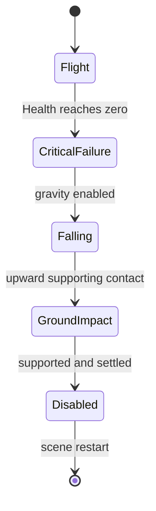

# Advanced drone combat, flight and destruction

Implemented on `feature/gv-asmadala-drone-animation` in Unity **6000.6.4f1**, 19 October 2026 (Asia/Colombo). This extends the uncommitted Phase 3 implementation; nothing was committed, pushed or merged.

## Dependency and scope

HEAD and `feature/player-camera-drone-separation` both already pointed to `1b986d8bb6e16305fae45cce5d1fe8372204dc4c`. The ancestry check passed. The working tree contained the previous approved animation changes, which were retained and extended. No older branch scripts were copied over the height, camera, collision, standoff or diagnostic improvements.

MainLab, all prefabs, imported models, materials, NavMesh data, packages and project settings remain unchanged. The implementation requires no serialized migration or teammate scene ownership changes. `DroneBody`, PlayerController, GameSession, A*, all four AI policies and gate rules remain unchanged. The protected-file manifest compares 166 files to the dependency commit.

## Runtime architecture

`DroneMotor` continues to own navigation and root yaw. Its Phase 3 cached recovery of missing visual references and legacy-hover ownership guard remain. `DroneRotorVisuals` owns the living model pose, independent rotor pivots, accepted-event feedback and the transition into destruction. It samples the movement actually accepted by DroneBody, after that component's LateUpdate.

`DroneAnimationPose` provides delta-time-based flight damping, transient firing/hit feedback and integrated rotor travel. Hover is limited to ±0.02 m, with a small stabilization roll; movement adds forward pitch, turns bank toward actual yaw change, and deceleration produces opposing pitch. Combined tilt is capped at 4°. The smaller bob reserves room for the requested larger bank without enlarging collision geometry. All four models passed the sampled maximum-tilt/hover/rotor-sweep check with **0.027393 m minimum clearance** inside their existing body envelopes.

Fatal damage transitions presentation through:



Flight includes idle, movement, turning, braking, firing and damage reaction. Fatal presentation has priority over every live state. The math helper retains its aggregate `Shutdown` state internally; the component's public `State` reports the actual destruction stage.

## Visible firing

`DroneBrain` retains its existing health, session, range, view, cooldown, overlap and final-ray checks. The final accepted ray now records `LastShotOrigin` and `LastShotHit` before the existing damage call and `ShotFired` notification. Neither damage nor cooldown changed.

`DroneWeaponEffects` builds one reusable effect rig per drone:

- A bright, short muzzle sphere, a localized point-light pulse and the existing small recoil response.
- A world-space LineRenderer tracer whose head advances along the accepted shot segment toward the actual hit point.
- Eight reusable electrical spark streaks for ground impact.

The muzzle is a lightweight runtime attachment. Cached self-collider ray queries locate the model surface along the validated firing direction; they never validate gameplay hits or apply damage. Both muzzle and tracer stay on the accepted segment. The muzzle starts just outside the model, avoiding the initial implementation's hidden flash on the longer models. A restrained body tint and localized light preserve model detail; the first rendered review exposed excessive whole-body whitening, which was reduced.

Effects are reused on every shot, have no active colliders, and create no additional damage. Death cancels any active muzzle/tracer and rejects subsequent firing presentation. Renderer material instances are created once for the runtime VFX rig and disposed on destruction; model material feedback uses cached MaterialPropertyBlocks. No matching existing audio clip was found, so no firing audio or audio asset was added. Smoke and shooting-impact sparks remain optional and are not implemented.

## Accepted damage

The existing `Health.Damaged` event carries `DamageRecord` after accepted damage, preserving attribution, diagnostics and the `Died` contract. Nonfatal hits briefly tint the model red/orange and add a small mechanical bank response, then stabilize. AI and attacks remain active. Rejected zero/negative damage and damage to dead Health do not produce reactions. Fatal hits invoke the destruction latch once instead of an ordinary hit reaction.

## Destruction, collision and stable wrecks

1. **Critical failure.** Existing DroneBrain death handling stops the motor, disables living colliders and notifies mission progression once. Presentation cancels weapon effects, flashes electrically, begins rotor deceleration and creates a separate wreck rig on the following LateUpdate, after all death handlers complete.
2. **Fall.** The existing visual is reparented at its current world pose to a new child rig under the stationary drone root. Only this rig receives a Rigidbody. The navigation root never receives a dynamic Rigidbody or an animation translation. Gravity begins after the brief critical interval, with bounded initial angular velocity producing loss of control.
3. **Contact.** The rig uses simple boxes for chassis bounds and low-vertex convex cylinders for rotor sweep. The original non-convex mesh colliders stay disabled. Continuous collision detection, gravity and supporting contact normals determine descent and impact; no world-floor height is hard-coded. Static walls, cover and gates remain collision surfaces. A wreck can correctly land on cover as well as the floor.
4. **Impact and settling.** The first upward supporting contact records one impact and emits the reusable sparks. A low-bounce contact material and angular damping allow a short physical settling reaction. Once supported and sufficiently settled, the rig becomes kinematic, rotors stop and collision proxies are disabled. The dark wreck remains visible until restart.

Falling rigs ignore player and drone collider pairs, so presentation cannot push or trap gameplay actors. Settled wrecks have no active collision proxies and cannot obstruct shots, consoles, doors or essential routes. Those choices intentionally make wrecks decorative after settling. They do not change the existing living-drone collision rules.

Enable/disable retains the falling or settled pose instead of restoring flying height. Disabling presentation also clears muzzle, tracer, light and impact streaks, so active sparks cannot freeze in view; the lifecycle fixture explicitly tests that cleanup. Re-enabling a dead visual does not recreate the rig or restart rotors. Tests exposed two shutdown edge cases: a one-frame mismatch between Disabled and zero rotor speed, and a supported sleeping Rigidbody stuck in GroundImpact after OnCollisionStay callbacks ceased. The settle notification now updates state/RPM together, and sleeping bodies with a recorded support impact can complete settling. The sleep regression was demonstrated failing before the fix. Existing emissive material properties also fade through property blocks without changing materials or shader keywords. Restart unloads the runtime rigs, materials and generated collider meshes.

## Inspector parameters

These code defaults appear on the existing DroneRotorVisuals component without saving prefab changes. Adjust them temporarily in Play Mode for review; stop Play Mode to discard those edits.

| Parameter | Default | Limits / purpose |
|---|---:|---|
| Rotor RPM | 390 | Base rotor speed; movement and firing modulate it. |
| Alternate Direction | true | Neighboring rotor counter-rotation. |
| Hover Amplitude | 0.02 m | 0–0.02 m; constrained by existing clearance. |
| Maximum Bank | 4° | 0–4°; combined pose also has a 4° safety cap. |
| Muzzle Flash Duration | 0.11 s | 0.08–0.15 s. |
| Tracer Duration | 0.13 s | 0.04–0.25 s. |
| Critical Failure Duration | 0.12 s | 0.02–0.25 s before gravity. |
| Wreck Tumble Speed | 65°/s | 10–100°/s initial angular speed, then damped. |

The 4° limit is the initial bank requested, constrained to the validated existing geometry. Larger angles, changed scales or replacement models need renewed clearance tests. Rigidbody mass/damping and spark appearance are code constants rather than new prefab tuning assets.

## Executed verification

| Complete final suite | Passed / total | Failures | Skipped | Duration |
|---|---:|---:|---:|---:|
| Edit Mode | **82 / 82** | **0** | **0** | 0.260 s |
| Play Mode, rendered Metal | **53 / 53** | **0** | **0** | 176.834 s |

The prior Phase 3 complete suites passed 82 Edit / 46 Play tests. This implementation adds seven destruction/rendered cases and extends the existing animation assertions. The final rendered suite includes the complete four-drone demonstration and the previously failing sleeping-body regression. `git diff --check` also passed. Raw XML, the confirmed pre-fix sleep failure, the initial geometry-fixture failure and source hashes are preserved in [evidence/drone-animation-advanced](evidence/drone-animation-advanced).

Tests ran in the isolated `/tmp/ShiftFour-AnimationValidation` copy using the installed Unity 6000.6.4f1 executable. The user's original editor and scene were not used to run or save tests. Native source and evidence are uncommitted.

The new destruction cases cover all four drones at 30, 60 and 120 FPS using temporary `Time.captureDeltaTime`, restored after each test. They assert actual world-height loss, gravity-driven falling, unchanged navigation roots, convex dynamic colliders, single impact, nonpenetrating mesh vertices above a raised floor, zero final rotor speed, stable final pose and nonblocking wrecks. Separate cases test wall/cover contact, exactly-once mission notifications and full scene restart cleanup.

Existing and extended tests cover accepted muzzle/tracer effects, target position, object reuse, range/cover/cooldown/dead-attacker rejection, nonfatal damage, subscription cleanup, imported geometry, flight state transitions, frame-independent math, A*, gate prerequisites, movement, standoff, sustained/multiple-attacker combat and player death/restart. No gameplay balance constants were changed.

Initial validation issues were resolved rather than hidden: the capture helper initially referenced an optional PNG conversion module absent from this project, so it now writes TGA without adding packages; the disabled-state rotor notification was made synchronous; the rendered fixture was moved beyond the existing arrival radius and renewed sight after Guard's legitimate cover movement. Those latter fixture corrections did not change navigation or AI. A full-suite run also exposed an older geometry fixture combining its manually imposed legacy ±0.08 m hover with the new runtime tilt. That fixture now disables presentation to restore rest tilt before testing its original hover extremes; its original clearance assertions are unchanged, and the separate animation sweep covers the new maximum combined pose.

## Rendered Unity demonstration

**All four sequences passed in rendered Unity Play Mode.** The test requires actual motor displacement and a heading change, a validated shot with visible flash/tracer, real player hitscan health loss, one physical impact and a stable Disabled state. There are **32 actual render captures**, eight per drone.

Open the [capture viewer](evidence/drone-animation-advanced/index.html) to compare stages. Individual PNG files are in [frames](evidence/drone-animation-advanced/frames). The images are losslessly converted from Unity's raw TGA captures; the source and PNG hashes are recorded in `captures.json`. Firing, fall/impact and wreck captures were visually inspected for Scout, Guard, Flanker and Interceptor. Small impact streaks can be partly occluded by the hull/contact point; their restrained appearance still benefits from artistic review in motion.

The demonstration loads the real MainLab and existing drone objects. It temporarily positions the player to obtain clear, reachable encounters, enables the real motor and policy updates, waits for an accepted drone shot, and invokes the real PlayerController hitscan method for nonfatal and fatal shots. It captures actual camera render textures using Metal. The original scene is never saved.

This is automated rendered verification, not a human playthrough or synthesized animation imagery. Player aiming/positioning and capture-camera placement are scripted; native mouse clicks and R-key input are not synthesized. The restart tests invoke the same Restart method used by R. Human input feel and artistic approval remain useful review steps.

## Performance

The final warmed presentation benchmark recorded **39.289 ms for 4,000 ticks**, with **0 managed bytes allocated** (about 0.00982 ms per visual tick). It includes hit-color transitions and the reusable effects update; it is not a whole-frame or GPU benchmark.

The existing 12-second rendered MainLab/Interceptor stress fixture recorded:

| Marker | Calls | Maximum calls per frame | Maximum total ms in a frame |
|---|---:|---:|---:|
| FindRoute | 38 | 2 | 0.109 |
| CanConnect | 57 | 3 | 0.088 |
| GoToCombat | 152 | 4 | 0.029 |
| ClearShot | 58 | 3 | 0.081 |
| DroneBody | 2,876 | 4 | 5.386 |
| SyncTransforms | 2,876 | 4 | 0.228 |

The 719 rendered frame samples had p50 **16.678 ms**, p95 **16.804 ms** and maximum **52.234 ms**, including Editor/test/pacing overhead. The largest frame spike is not attributed to animation or any single marker by this capture. No optimization or balancing change was made on that assumption. A standalone Development Build GPU/native-physics profile remains unperformed. Full output is in [performance.txt](evidence/drone-animation-advanced/performance.txt).

Living presentation performs no navigation query or additional Physics.SyncTransforms call. Cached self-collider muzzle queries occur only on accepted shots. Per-shot objects and materials are reused. Wreck construction allocates its rig and simple collider meshes once per death; these are destroyed on scene unload. The allocation benchmark concerns warmed presentation ticks, not initialization, physics engine allocation or complete rendered frame cost.

## Preview and manual acceptance

1. Open MainLab in Unity 6000.6.4f1 and enter Play Mode. Leave runtime scene edits unsaved. F3 shows the existing policy decisions; enable Health's development damage diagnostics when correlating hits.
2. Repeat in **Checkpoint / Scout**, **Server / Guard**, **Control / Interceptor**, and **Storage / Flanker**. Watch idle hover and four independent rotors. Approach from far enough away to require travel; standing already inside standoff plus stopping distance correctly produces a hold.
3. Move laterally in view, then take cover. Observe pitch during travel, banking on turns and settling at arrival. Guard may deliberately move into cover; reveal yourself again to obtain a valid shot. These policies remain independent of presentation.
4. In clear view and within range, look for the short muzzle flash, localized light, recoil and advancing tracer. Use solid cover and move out of range to verify that rejected attempts do not emit new effects. A previous accepted shot's brief effect may still finish.
5. Shoot once: observe the warm damage flash and small stabilizing reaction while the drone continues its normal policy. Deliver the fatal shot: electrical failure must override hit/fire feedback, navigation stops, rotors slow, the rig tilts and falls.
6. Watch contact with the actual floor or intervening cover. Check the one-time spark burst, small physical settling response, stopped rotors and dark stable wreck. Walk past it and operate the required console/gate; the final wreck must not block progression.
7. Inspect a death near a wall and below/above cover in Scene view. Existing tests cover representative floor/wall/cover contacts, not every possible geometry configuration or extreme external teleport. Wreck proxies are conservative simple shapes, not destructible mesh fragments.
8. Toggle the visual component or drone GameObject temporarily in Play Mode; dead models must not return to flying height or restart their rotors. Allow player death and press R: health, drones, effects and gates should reset.
9. Use Test Runner to run both complete suites. Run `RenderedMainLab_AllFourAcceptedCombatAndDestructionSequences` with graphics enabled to reproduce the captured demonstration. With a Null graphics device that one case is explicitly ignored.

Batch reproduction (closed or isolated project; omit `-nographics` for the rendered case):

```sh
/Applications/Unity/Hub/Editor/6000.6.4f1/Unity.app/Contents/MacOS/Unity \
  -batchmode -force-metal -projectPath /tmp/ShiftFour-AnimationValidation \
  -runTests -testPlatform PlayMode \
  -testResults /tmp/ShiftFour-AdvancedEvidence/review-play.xml \
  -logFile /tmp/ShiftFour-AdvancedEvidence/review-play.log
```

Use `-testPlatform EditMode -nographics` for Edit Mode. `SHIFTFOUR_DEMO_OUTPUT` optionally selects the TGA capture directory; its default is `/tmp/ShiftFour-AdvancedEvidence/frames`.

## Files changed

| File | Responsibility |
|---|---|
| `Assets/Scripts/Gameplay/DroneRotorVisuals.cs` | Flight ownership, configurable presentation, accepted events, material feedback and destruction handoff. |
| `Assets/Scripts/Gameplay/DroneAnimationPose.cs` + meta | Flight math, rotor integration and presentation states; extends Phase 3. |
| `Assets/Scripts/Gameplay/DroneWeaponEffects.cs` + meta | New reusable muzzle, light, tracer and impact sparks. |
| `Assets/Scripts/Gameplay/DroneWreckMotion.cs` + meta | New gravity/contact/settling controller and simple runtime collision proxies. |
| `Assets/Scripts/AI/Core/DroneBrain.cs` | Accepted shot endpoint data; retains Phase 3 presentation event and death unsubscription. |
| `Assets/Scripts/AI/Movement/DroneMotor.cs` | Carried-forward Phase 3 binding recovery and single-owner hover guard. |
| `Assets/Scripts/Gameplay/Health.cs` | Carried-forward accepted-damage event; attribution and development diagnostics preserved. |
| `Assets/Tests/EditMode/Movement/DroneAnimationEditModeTests.cs` + meta | Flight/priority/time-step tests, including natural stabilization bounds. |
| `Assets/Tests/PlayMode/DroneAnimationPlayModeTests.cs` + meta | Extended firing, lifecycle, pose clearance and allocation checks. |
| `Assets/Tests/PlayMode/CombatAuditPlayModeTests.cs` | Restore rest pose before its existing manual legacy-hover geometry sweep; original assertions retained. |
| `Assets/Tests/PlayMode/DroneDestructionPlayModeTests.cs` + meta | New physical fall, impact, stable wreck, restart and rendered demonstration cases. |
| `docs/members/04-movement-interceptor.md` | Connect the implementation and acceptance steps to the Agent Controller responsibility. |
| This report, Phase 3 report status, and `docs/evidence/drone-animation-advanced/` | Actual results, captures, source/protected-file hashes and performance evidence. |

No scene, prefab, imported model, material or project-setting approval is pending because none was changed. No audio, smoke, mesh fracture, player-pushing wreck physics or standalone-player build validation is claimed.
